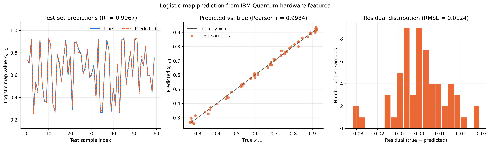
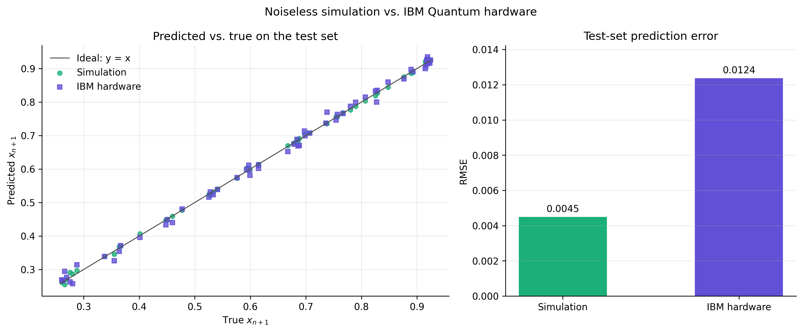

# Quantum Hardware Results

## Overview

This directory contains results from evaluating a time-encoded quantum reservoir computing model on real IBM Quantum hardware. The experiment investigates whether the predictive performance demonstrated in simulation can be retained when the reservoir is executed on a physical quantum processor.

## Results

### Hardware Prediction Diagnostics

The figure summarizes the model's predictions on the test set, the relationship between predicted and reference values, and the residual errors.

### Simulation vs. Hardware

This figure compares the predictive performance obtained in simulation with that measured on real quantum hardware, illustrating the effects of finite-shot measurements and device noise.

## Quantitative Evaluation

| Execution environment | Test RMSE |
|---|---:|
| Ideal simulation | 0.00450 |
| IBM Quantum hardware | 0.01238 |
