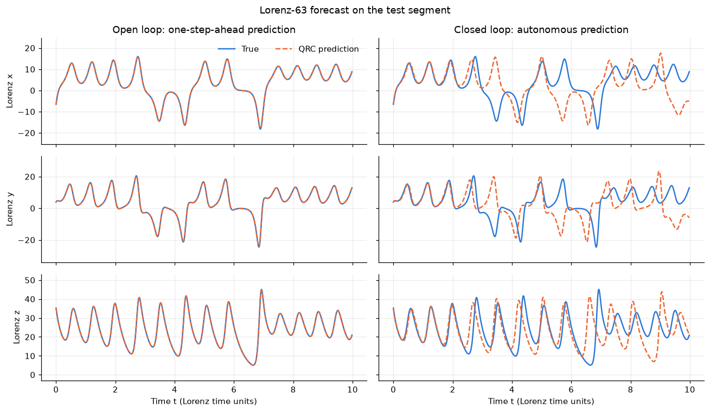
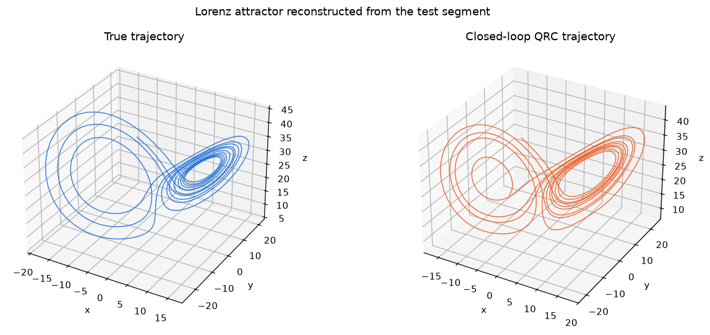
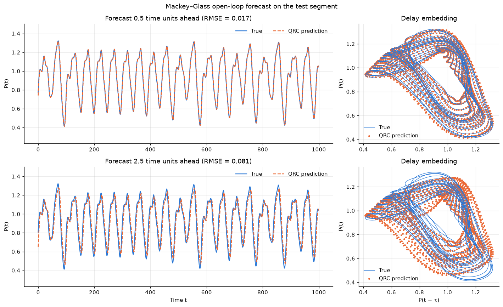
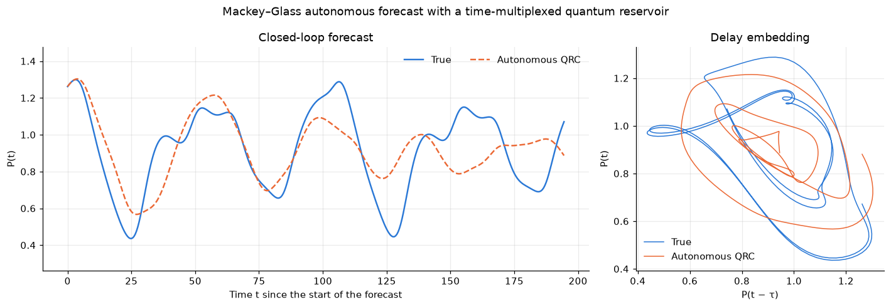

# Quantum reservoir computing for chaotic time series

`qrc_chaotic_time_series.ipynb` simulates a six-qubit quantum reservoir with Qiskit and uses it to forecast two chaotic benchmark systems: the Lorenz-63 attractor and the Mackey–Glass delay equation. Only a linear readout is trained; the quantum circuit itself has fixed random parameters.

## Method

| Step | Description |
|---|---|
| Reservoir | Six qubits prepared in \|+⟩. One layer applies `RZ(-2 ω_i T_i)` on every qubit and `RXX(-(T_i + T_j) J_ij)` on every pair, with random frequencies ω_i ∈ [0.5, 1.5] and couplings J_ij ∈ [0.1, 0.5] (seed 42). |
| Input encoding | The input sets the evolution time, `T = T0 + α · tanh(u / s)` with `T0 = 0.5`, `α = 1`. For Lorenz the three coordinates are distributed over the qubits (`s = 30`); for Mackey–Glass all qubits share one time (`s = 5`). |
| Features | Exact single-qubit Pauli expectation values from the statevector (Z, X and Y for Lorenz, Z for Mackey–Glass), together with their squares. |
| Readout | Linear regression (ridge regression in the autonomous Mackey–Glass experiment), trained on the first 80 % of the series and tested on the last 20 %. |

## Experiments and results

| Experiment | Setup | Test RMSE |
|---|---|---|
| Lorenz-63, open loop | One-step-ahead prediction (Δt = 0.01), true state fed in at every step | 0.031 |
| Lorenz-63, closed loop | Model runs autonomously on its own predictions for 10 time units | 9.72 |
| Mackey–Glass, open loop | Forecast 0.5 time units ahead | 0.017 |
| Mackey–Glass, open loop | Forecast 2.5 time units ahead, readout trained for this horizon | 0.081 |
| Mackey–Glass, closed loop | Time-multiplexed reservoir (40 virtual nodes) with a 10-tap delay line, autonomous for 195 time units | 0.170 |

The Lorenz and Mackey–Glass signals have amplitudes of roughly ±20 and 0.4–1.3 respectively, so the errors of the two systems are not directly comparable.

In open loop the reservoir reproduces both systems closely. In closed loop the Lorenz forecast follows the true trajectory for about two time units before diverging, as expected for a chaotic system, while the generated trajectory still has the two-lobe shape of the attractor. The autonomous Mackey–Glass forecast tracks the first oscillation and then loses phase and amplitude.









## Running the notebook

```bash
pip install -r requirements.txt
jupyter notebook qrc_chaotic_time_series.ipynb
```

The notebook needs no IBM Quantum account and runs in about one minute on a laptop. All random parameters are seeded, so the numbers above are reproducible.

